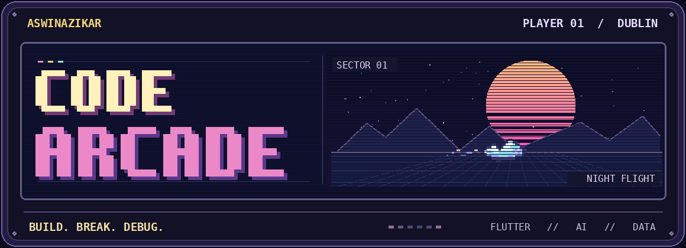

<picture>
  <source media="(prefers-reduced-motion: reduce)" srcset="./assets/cabinet.png">
  
</picture>

# Aswin’s Code Arcade

I’m Aswin Manmathan S. I build Flutter apps, experiment with AI and NLP, and turn messy data into something worth plotting.

[Explore my repos](https://github.com/AswinAzikar?tab=repositories) · [Find me on LinkedIn](https://www.linkedin.com/in/aswin-manmathan-s/)

## 🕹️ Game select

| Repository | What’s inside |
| --- | --- |
| [FinGuard AI](https://github.com/AswinAzikar/FinGuard_AI) | An in-progress experiment in catching rare credit card fraud without drowning in false alarms. |
| [Support Triage Assistant](https://github.com/AswinAzikar/support-triage-assistant) | A Python project that helps triage support requests. |
| [MovieFlix](https://github.com/AswinAzikar/movieflix) | A Flutter movie discovery app with a watchlist for films I’ll definitely watch someday. |
| [FeatureRichArchFlutter](https://github.com/AswinAzikar/FeatureRichArchFlutter) · [sider](https://github.com/AswinAzikar/sider) | A feature-driven Flutter starter and a reusable side navigation package. |
| [Ireland GTFS Transport Analytics](https://github.com/AswinAzikar/gtfs-transport-analytics-ireland) · [Retail Sales Analytics](https://github.com/AswinAzikar/retail-sales-analytics-sql-powerbi) | Public transport schedules in one project, SQL and Power BI retail analysis in the other. |

## 🎒 Tech stack & skills

### AI & data

  
  
  
  
  
  

### App development

  
  
  
  
  
  

### Skills

  
  
  
  
  
  

## 📊 High scores & contribution graph

[See live contribution activity](https://github.com/AswinAzikar#js-contribution-activity)

## 🏆 Trophy cabinet

| Quickdraw | Pull Shark ×2 | YOLO |
| :---: | :---: | :---: |
|  |  |  |

## 💬 Dev quotes

> I said “one small refactor.” Git said “47 files changed.”

> My favourite debugger is explaining the bug out loud and hearing how ridiculous it sounds.
