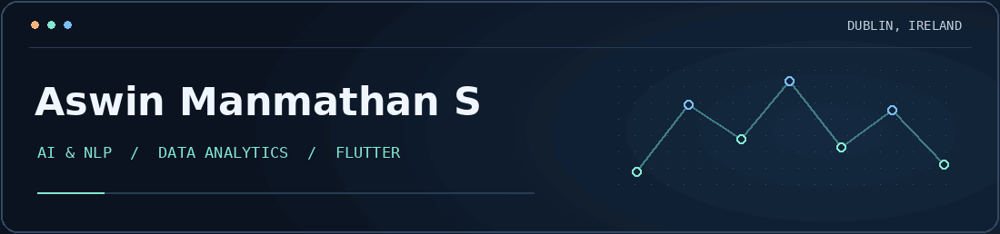

<picture>
  <source media="(prefers-reduced-motion: reduce)" srcset="./assets/profile-banner.png">
  
</picture>

# Hi, I’m Aswin Manmathan S

I’m a software developer based in Dublin, Ireland. I build Flutter apps, develop machine learning and NLP projects in Python, and use SQL and Power BI to answer business questions. My MSc in Computing at Dublin City University focused on AI and Natural Language Processing.

[LinkedIn](https://www.linkedin.com/in/aswin-manmathan-s/) · [Browse my repositories](https://github.com/AswinAzikar?tab=repositories)

## Featured projects

| Project | What I built |
| --- | --- |
| [FinGuard AI](https://github.com/AswinAzikar/FinGuard_AI) | An in-progress fraud detection project exploring class imbalance and the precision–recall trade-off in credit card transactions. |
| [Support Triage Assistant](https://github.com/AswinAzikar/support-triage-assistant) | A Python project for triaging support requests. |
| [Retail Sales Analytics](https://github.com/AswinAzikar/retail-sales-analytics-sql-powerbi) | A retail sales analysis project using SQL and Power BI. |
| [Ireland GTFS Transport Analytics](https://github.com/AswinAzikar/gtfs-transport-analytics-ireland) | An analysis project using Irish public transport schedule data. |
| [FeatureRichArchFlutter](https://github.com/AswinAzikar/FeatureRichArchFlutter) | A Flutter project demonstrating feature-driven application architecture. |
| [MovieFlix](https://github.com/AswinAzikar/movieflix) · [sider](https://github.com/AswinAzikar/sider) | A Flutter movie discovery app with a watchlist, and a reusable Flutter side navigation package. |

## Tech stack

- **AI and data** · Python, PyTorch, scikit-learn, pandas, SQL, Power BI
- **App development** · Flutter, Dart, BLoC, Firebase, Node.js, REST APIs
